# Mods tour

Every mod in this repo, with a screenshot of it running. The screenshots come from a demo copy of
this config (`HERDR_APP_HOME` pointed at a scratch folder) with a made-up project, `acme-shop`, and
made-up Jira tickets and pull requests. The agents in them are real Claude Code sessions.

Layout: `main-tasks`. Theme: `ember`.

## The main window

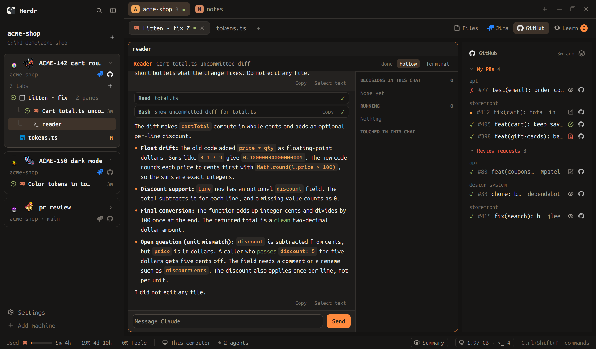

| Mod | Where it is |
|---|---|
| `space-tabs` | The strip across the top: one tab per root workspace (`acme-shop`, `notes`). A root is a folder; a click goes to the root's last dev workspace. |
| `space-panel` | The sidebar cards, one per dev workspace (a Herdr space). Each card has its Pokémon, its tabs, panes and sub-agents, a status per agent, and Jira and GitHub buttons. |
| `tabs-tasks` | The tab bar, with the Files, Jira, GitHub and Learn buttons on the right. The side panel is remembered per dev workspace. |
| `reader` | The middle pane. It stands in for a Claude pane's terminal (see below). |
| `tasks` | The GitHub rail on the right: my PRs, then review requests, grouped by repo, with check and review state. |
| `status-usage` | The status bar: Claude plan usage at the left, the Summary chip, and the resources chip (memory and terminal count). |
| `chrome-dev` | The sidebar footer. Settings opens a menu with this config's own switches, then Herdr's Settings window. |

### Reader

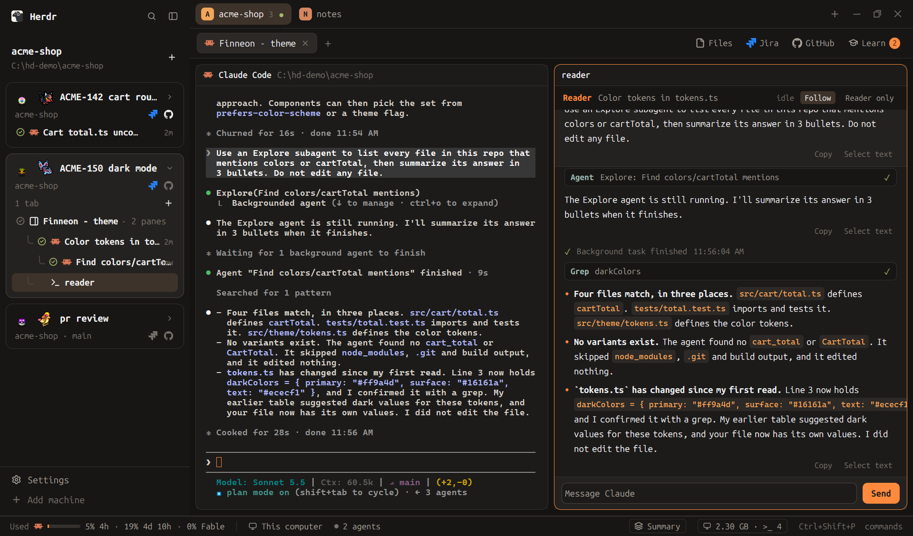

`reader` reads the Claude session's transcript and draws the chat with colors by meaning:
tickets, PRs, paths, commands, pass and fail. Tool output folds into one row per call. The right
column lists the decisions made in the chat, what is running, and the tickets and PRs the chat
touched. When Claude asks a question or shows a permission prompt, the Reader docks it with
one-tap answer buttons, and its own message box types into the terminal. It uses no model tokens.

Here the Reader sits beside the terminal it reads. In the sidebar, the `ACME-150 dark mode` card
shows the agent, its Explore sub-agent nested under it, and the reader pane.

### Sub-agent view

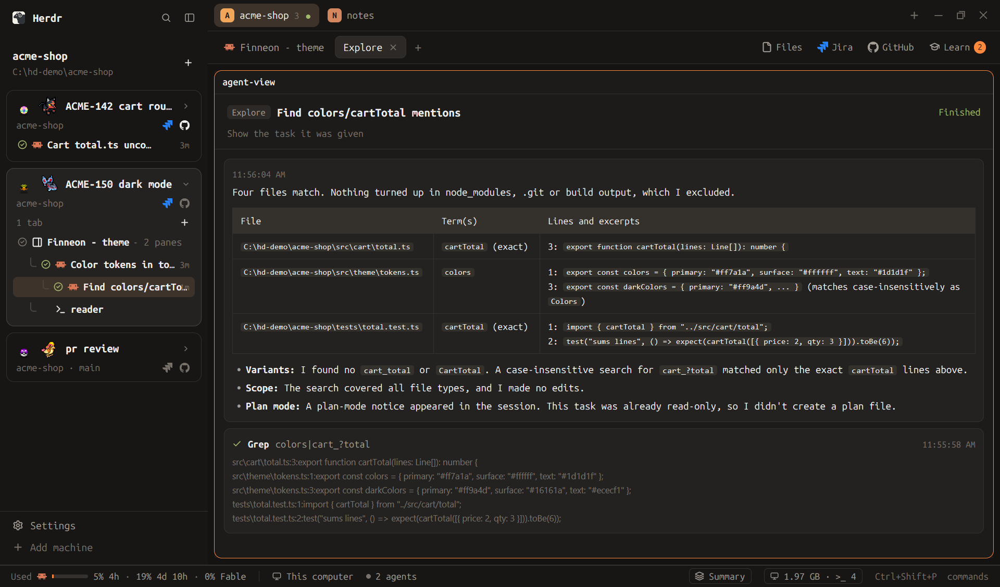

`agent-view` opens a Claude sub-agent as a tab: what it was asked, what it is doing now, and each
step it took, newest first. A click on a sub-agent's row in the sidebar opens it. The view follows
the sub-agent's transcript live.

## Side panel

### Jira rail

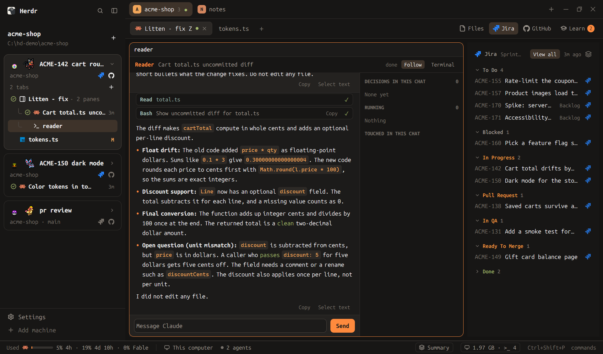

The `tasks` mod also draws the Jira rail: my tickets grouped by board column, with Done folded.
Backlog tickets carry a Backlog tag. A row opens the ticket's detail drawer (description, status
move, comments).

### Files and the file tab

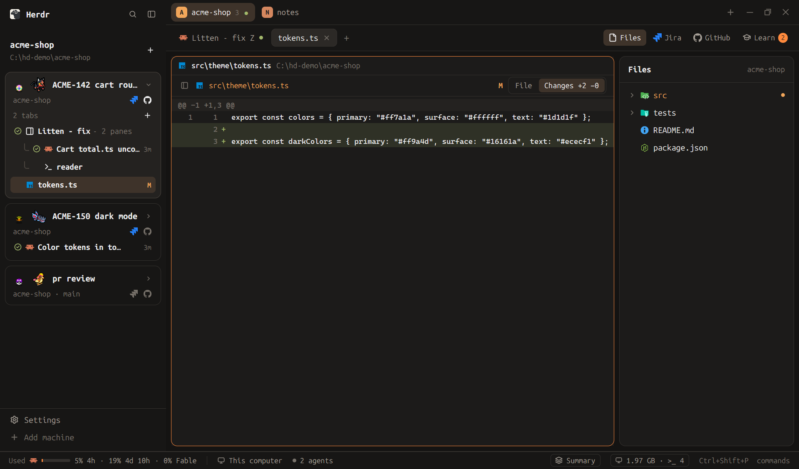

- `files-dev`: the file tree in the side panel. A click opens the file as a tab in the selected dev
  workspace, with git marks that work on Windows paths.
- `file-view`: the file tab. It follows the disk, and a file with git changes opens on its diff
  against `HEAD` (File / Changes toggle). Saving refuses to overwrite a file that changed on disk.
- `file-icons`: VS Code style icons (Material Icon Theme) in the tree, the tabs and the cards.
- `pane-dev`: the pane header above each pane: program icon, the agent's name or the file, the
  folder, and split, zoom and close buttons.

### Learn

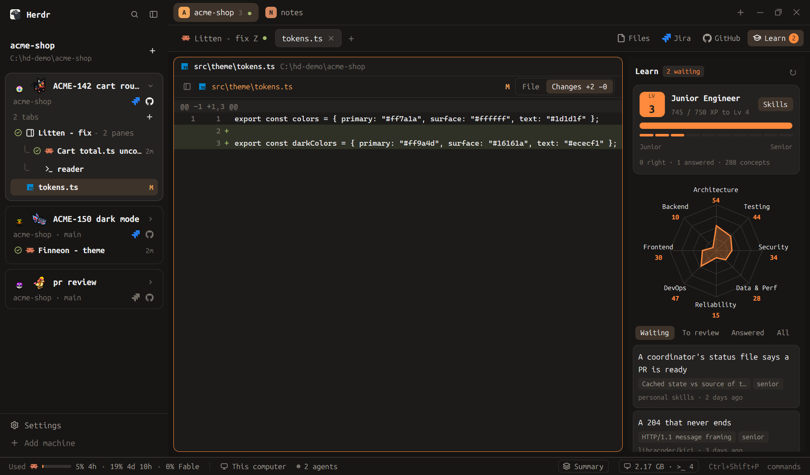

`learn` is the inbox for the `learn-swe` Claude Code skill. While I work, agents add short
senior-level questions about the task at hand. The pane lists them, takes my answer, and shows the
grade and the model answer. The top shows a level and a skill radar built from the answers.

## Dialogs

### Tasks board

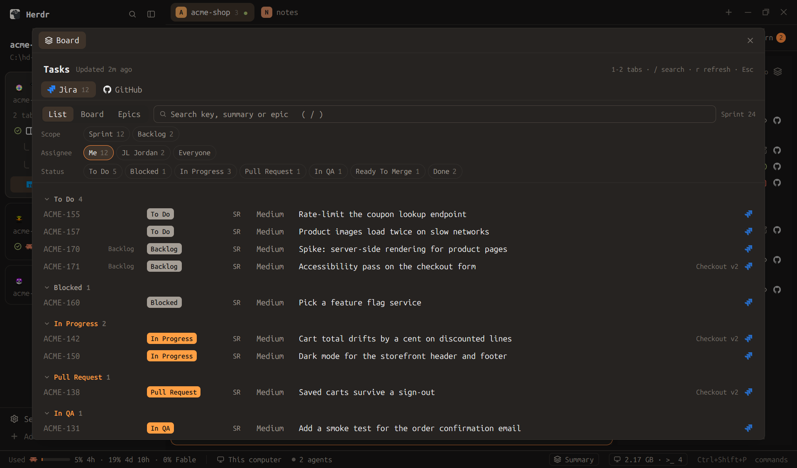

`tasks` again, as a full board (`ctrl-shift-j`): Jira and GitHub tabs, List / Board / Epics views,
search, and filters by scope (sprint, backlog), assignee and status. **Start workspace** on a ticket
or PR makes a dev workspace named after it, with a Claude agent and a first prompt.

### Workspace summary

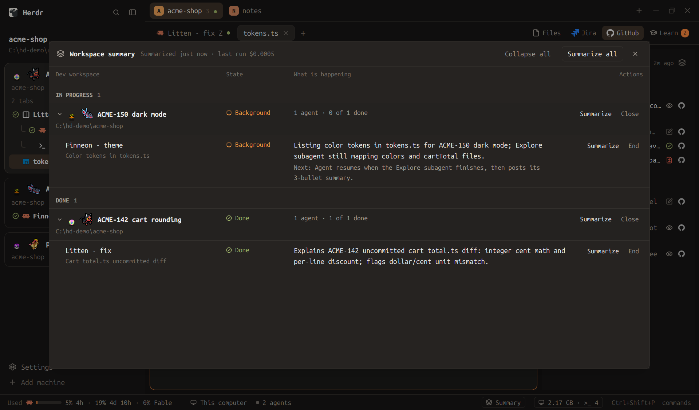

`space-summary` opens from the Summary chip in the status bar. It lists every dev workspace that
has agents, in progress first, with what each agent is doing. Haiku writes the summaries (one
`claude -p` call for the agents that changed, a fraction of a cent). Rows come from the live window, so a
closed workspace drops out at once.

### New workspace

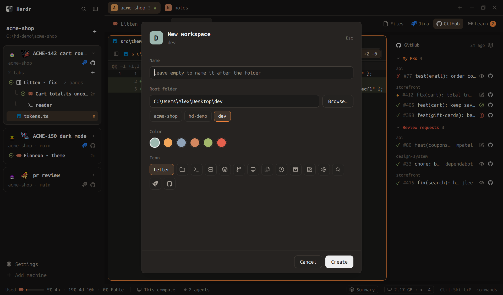

`space-new` makes a root workspace or a dev workspace: name, folder, color, icon, and a shell or an
agent with a first message. It also edits an existing one. Its Pokémon picker lists all 1,025
(see the README).

### Resource Manager

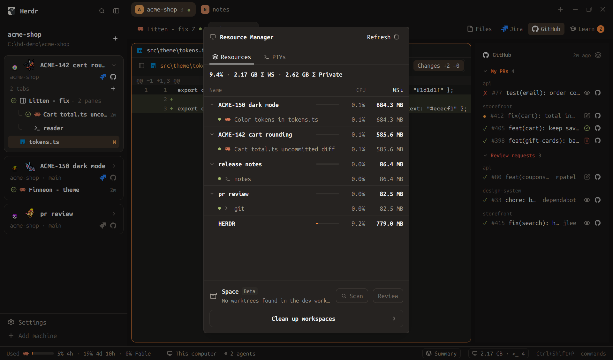

`resources` opens from the resources chip. It shows what each dev workspace costs (CPU, working
set, private memory) as the whole process tree of each terminal, with Herdr's own processes as
their own group. The PTYs tab lists every live terminal, hidden ones too, with a kill button.

## Plain terminals and more roots

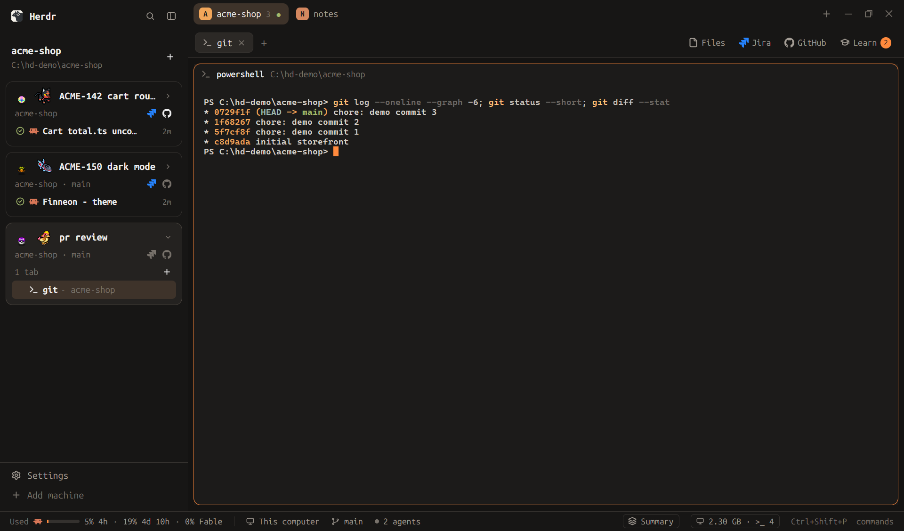

A shell tab is a plain terminal under the `pane-dev` header. The card lists it like an agent.

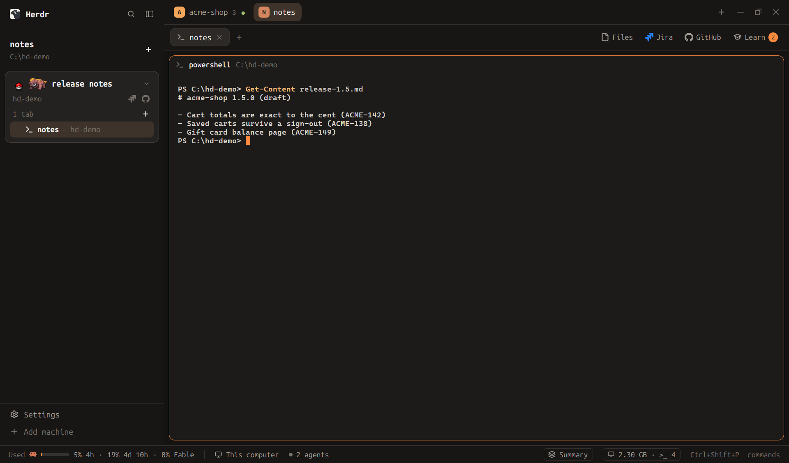

A second root (`notes`) has its own dev workspaces. The sidebar shows only the selected root's
cards.

## Mods without a screenshot

| Mod | What it does |
|---|---|
| `menu-spaces` | Right-click menu for the cards: edit, lock, close. |
| `agents-space` | Agents list limited to the active dev workspace, so next/previous agent keys stay inside it. |
| `hibernate` | Invisible. Every 5 minutes it puts idle Claude panes to sleep (`claude/hibernate.mjs`) to save memory, and wakes one in place when it is selected. The switch is in the Settings menu. |
| `browser` | A browser tab. Herdr has no web view, so `hx/browser.mjs` runs one shared headless Chrome and the tab draws its screencast frames, sending clicks, scrolling and keys back. Agents drive the same page with `hx browser ...`. |
